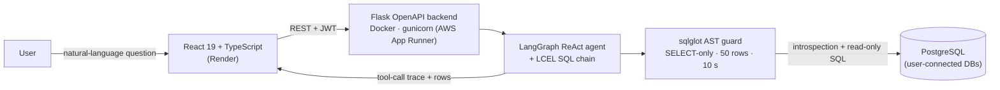

# Multi-Focused AI Dashboard

[](https://multi-focused-ai-dashboard-frontend.onrender.com/dashboard)
[](https://github.com/Jas2005-ct/Multi-focused-AI-Dashboard/actions/workflows/ci.yml)
[](backend/pyproject.toml)
[](frontend/package.json)

Connect multiple PostgreSQL databases and ask them questions **in plain English**.
A LangGraph ReAct agent discovers your schema, decides which tool to call, generates
SQL, validates it, runs it **read-only**, and answers back — no SQL required.

**Try it live → [multi-focused-ai-dashboard-frontend.onrender.com/dashboard](https://multi-focused-ai-dashboard-frontend.onrender.com/dashboard)**

## Architecture



## What it does

- **Multi-database connections** — register several PostgreSQL databases per account; connect your own or the built-in demo database (synthetic e-commerce data, read-only account).
- **Three query modes**
  - `auto` — LangGraph ReAct agent picks the right tool (default)
  - `sql` — direct LCEL chain SQL generation
  - `answer` — data-only output for programmatic use
- **Schema introspection tools** — `list_tables`, `describe_table`, `count_rows`, `sample_rows`, `run_sql_query`; the agent discovers the schema instead of guessing table names.
- **Full transparency** — every answer comes back with the tool-call trace and the underlying rows rendered by the UI (the agent is instructed *not* to re-type markdown tables).
- **Auth & rate limiting** — JWT bearer auth with refresh tokens, optional Google OAuth, request rate limiting.

## Read-only by construction

Agent answers are sandboxed before anything touches your database:

- **sqlglot AST validation** — only `SELECT` / `WITH` (CTE) statements pass; `INSERT`, `UPDATE`, `DELETE`, `CREATE`, `ALTER`, `DROP`, `TRUNCATE`, `MERGE`, … are rejected before execution.
- **Write-intent detection** — plain-language write requests are refused without calling tools.
- **Blast-radius limits** — max 50 rows per tool result, 10-second statement timeout, system/hidden tables filtered from listings, the agent, and generated SQL.

## Tech stack

| Layer | Tools |
|---|---|
| AI | LangGraph (`create_react_agent`), LCEL, LangChain-core, sqlglot, Groq / OpenRouter LLMs (pluggable) |
| Backend | Python 3.10+, Flask 3 (flask-openapi3 + Swagger), SQLAlchemy 2, Flask-Migrate, Flask-Limiter, Celery/Redis (async tasks) |
| Frontend | React 19, TypeScript, Vite, React Router 7 |
| Infra | Docker + gunicorn, AWS App Runner (backend), Render (frontend), GitHub Actions CI |

## Project structure

```
backend/
  app.py               # Flask app factory, /health
  config.py            # single source of truth for env-driven settings
  ai/
    agents/            # ReAct agent + LCEL SQL chain
    guards.py          # sqlglot AST validation + write-intent detection
    tools/             # introspection tools exposed to the agent
    llm_factory.py     # LLM provider resolution + fallbacks
  ai_dashboard/        # /api/v1 routes (query, schema, connections)
  auths/               # JWT auth, refresh tokens, Google OAuth
  connections/         # multi-database connection management
frontend/              # React 19 + Vite dashboard
```

## Quick start

**Backend** (Python 3.10+, [uv](https://docs.astral.sh/uv/)):

```bash
cd backend
uv sync                 # or: pip install .
cp .env.example .env    # then fill in the values below
uv run gunicorn -w 2 -b 0.0.0.0:8000 "app:create_app()"
```

Key environment variables (full list in `backend/config.py`):

| Variable | Purpose |
|---|---|
| `DATABASE_URL` | App's own database (users, connections, auth) |
| `SECRET_KEY` | ≥ 32 bytes; fails fast in production without it |
| `GROQ_API_KEY` (or `OPEN_ROUTER_API_KEY`, `OPEN_ZEN_API_KEY`) | LLM provider — resolution order in `ai/llm_factory.py` |
| `DEMO_DB_URL` | Read-only demo database behind the "Add demo database" button (empty = disabled) |
| `ENABLE_GOOGLE_OAUTH`, `GOOGLE_CLIENT_ID`, `GOOGLE_CLIENT_SECRET` | Optional Google sign-in |

**Frontend** (Node 18+):

```bash
cd frontend
npm ci
npm run dev             # http://localhost:5173
```

## Testing

Every test runs against a throwaway SQLite file — a SQLAlchemy-level guard makes any
write (INSERT/UPDATE/DELETE/DDL) against a real database fail the suite. `SELECT`
queries are allowed for read-only checks.

## Deployment

- **Backend**: Dockerized (`backend/Dockerfile`), deployed to AWS App Runner (`apprunner.yaml`) with a `/health` liveness check.
- **Frontend**: deployed on Render — [live dashboard](https://multi-focused-ai-dashboard-frontend.onrender.com/dashboard).
- **CI**: GitHub Actions (`ci.yml`) runs on every push.
